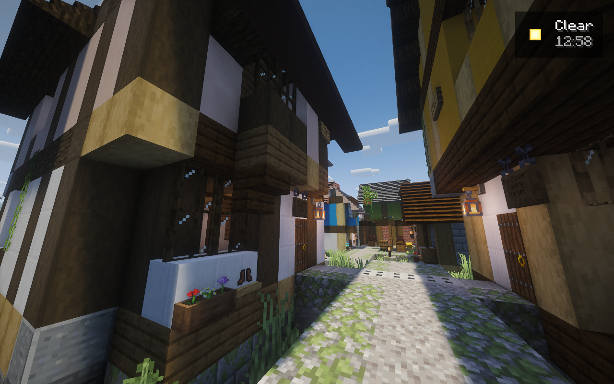
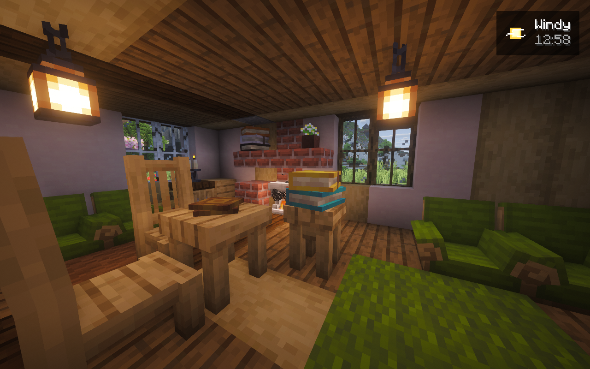

# A World for Two

**Our little corner of an endless world.**


A cozy Minecraft home for KG and Sera: cottage gardens and kitchens, a busy pirate
waterfront, Rosewater Castle, sailing adventures and Create machinery.

**Minecraft 1.21.1 · NeoForge 21.1.262 · Java 21 · Prism Launcher · Packwiz**

## Build status

| Build | Availability | Enabled mods |
| --- | --- | --- |
| **Public candidate.31** | Published, immutable prerelease; fresh Prism import remains unqualified | **197 total · 191 client · 164 server** |
| **Private candidate.46** | Private preview observed online; validation in progress; unreleased | **198 total · 192 client · 165 server** |

Shared mods count on both sides. Essential is optional and disabled. Eight shader
choices and one resource pack are pinned. The public starter retains its own
candidate.31 snapshot; it does not contain the private candidate.46 work.

The full build is still in progress: a continuous, dense north-bank pirate town;
a complete 3D architecture pass; flowers, climbers and native-grown woodland;
and a separate living LIFE pass for animals and residents. Seven native-grown
trees are confirmed in saved data; no curated LIFE population has been spawned.
The refined fountain sculpture is placed, with its full powered-function test
still pending. Candidate.46 completed native startup, a normal save/stop and a
private preview restart. The licensed owner client has now joined; full
multiplayer, public-import and full-world acceptance remain open. See [current status](docs/STATUS.md) and [the recovery record](docs/NATIVE-CANDIDATE46.md).

## Install the public prerelease

1. Download the [candidate.31 Prism ZIP](https://github.com/Kgray44/a-world-for-two/releases/download/awft-0.1.0-candidate.31/A-World-for-Two-0.1.0-candidate.31-Prism.zip).
2. In [Prism Launcher](https://prismlauncher.org/), choose **Add Instance → Import
   from ZIP**, sign into your licensed Minecraft Java account, and select **Java 21**.
3. Use **6 GiB maximum memory for KG** or the conservative **4 GiB for Sera**.
   Keep the included Packwiz pre-launch step enabled so it retrieves the pinned
   client files. Start with shaders off.
4. Join when the host confirms that the matching server and tunnel are running
   and your Java username is whitelisted. Keep optional Essential off for the
   normal dedicated-server setup.

The ZIP and published checksum were verified. A clean fresh import still needs
qualification; the [candidate.31 installation record](evidence/runtime/artistic-release-candidate.31.json)
preserves the earlier download failures. Accounts, worlds, backups and LOD
history stay outside the client ZIP. One unchanged pirate mod is included under
its author's [modpack permission](docs/PIRATE-MODPACK-PERMISSION.md).

## From the actual game





These are unchanged, historical Minecraft captures from the private artistic
world using Complementary Reimagined. [Capture provenance](evidence/runtime/artistic-recovery-detail-20261027.json).
The small pirate-town area is the owner's accepted visual reference; full-world
artistic acceptance remains open.

## Explore together

| At home | Out exploring |
| --- | --- |
| Furnished cottages, gardens, kitchens and music | Mountains, oceans, ruins and archaeology |
| Rosewater Castle and intimate craft lanes | Pirate waterfronts, sailing ships and belowdecks |
| Shops, courts and warm evening lighting | Fishing, treasure, weather and ocean wildlife |
| Custom menu and animated workstation interactions | Xaero's maps, parties/claims, Waystones and browser Atlas |
| Create workshops and a powered river drawbridge | Trains, Small Ships, Aeronautics/Sable and Hypertubes |

Feature selection, construction and working gameplay have separate checks.
Earlier native builds completed real 55° drawbridge cycles across a restart;
new moving ornaments, the continuous zipline and other Create demonstrations
still have their own admission and commissioning work.

**Distant Horizons + SeedGen** remains the distant-terrain architecture. Voxy and
Roxy are excluded. Strict client/server parity is still unresolved; DH server
LOD downloads remain the fallback. Kappa, Bliss and six other shaders are pinned;
Chocapic remains deferred. The [compatibility inventory](docs/COMPATIBILITY.md)
retains every requested candidate, while [the development lock](catalog/lock.json)
records exact versions, sides and hashes.

## Control Room

The local dashboard provides server controls, whitelist and operator editing,
player coordinates, Atlas waypoints, live storage, backups, mod proposals, menu
artwork, graphics choices and Playit.gg service controls.

```powershell
python -m pip install -e .
python -m control_room run --home "D:\A World for Two"
```

Open **http://127.0.0.1:8765**. Changes require the local origin and current session
token. See [the dashboard guide](docs/CONTROL-ROOM.md).

## Guides and development

- [Current status](docs/STATUS.md), [installation notes](docs/INSTALL.md) and [shader choices](docs/SHADERS.md)
- [Artistic recovery](docs/ARTISTIC-RECOVERY.md), [north-bank shops](docs/ARTISTIC-NORTH-BANK-WEST.md) and [streets and tavern depth](docs/ARTISTIC-WEST-STREETS-AND-ROSE-EXTERIOR.md)
- [Fountain](docs/FOUNTAIN-CENTERPIECE-RECOVERY.md), [forest](docs/WHOLE-SOUTH-BANK-FOREST.md), [botanical art](docs/ARTISTIC-BOTANICAL-PASS.md) and [living LIFE](docs/SETTLEMENT-LIFE.md)
- [Create attractions](docs/SETTLEMENT-ATTRACTIONS.md), [zipline](docs/ARTISTIC-ZIPLINE-WEST.md), [cinematics](docs/SETTLEMENT-CINEMATIC.md) and [remaining showcase work](docs/SHOWCASE-COVERAGE.md)
- [Release process](docs/RELEASING.md) and [third-party notices](docs/THIRD-PARTY.md)

```powershell
python -m unittest discover -s tests -v
python -m tools.pack validate
node --check control_room/static/app.js
node --test tests/session.test.mjs
```

This repository contains source, configuration, original artwork and sanitized
evidence. Saves, credentials, downloaded third-party JARs, logs and caches remain
private. Local writers reserve **30 GiB free separately on C: and D:**; this
monitoring rule does not constrain other applications. Cleanup preserves useful
recovery snapshots and failed receipts.
