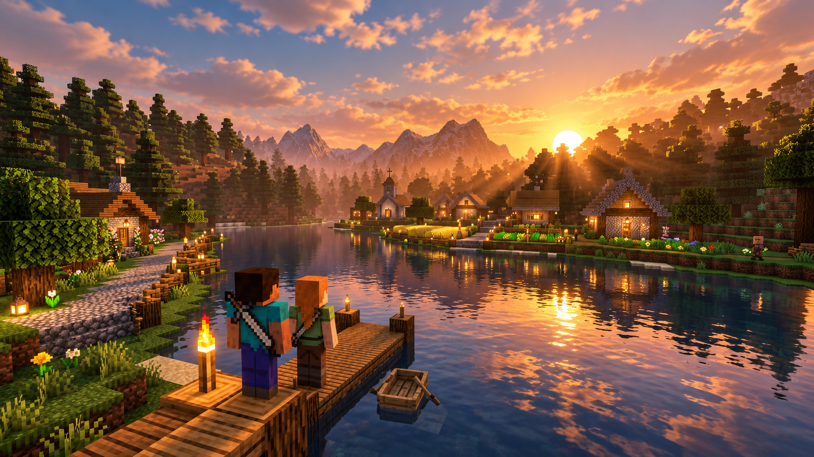

# A World for Two

**Our little corner of an endless world.**



A cozy Minecraft home for KG and Sera, with gardens, fairytale rooms and working
crafts close by, and mountains, pirate harbors and mechanical adventures beyond.

**Minecraft 1.21.1 · NeoForge 21.1.262 · Java 21 · Prism Launcher · Packwiz**

Candidate **0.1.0-candidate.23** contains **197 enabled mod JARs**, **eight shaders**
and one resource pack. The permanent server now contains the expanded castle,
south-bank village and grand sailing harbor. Their native block/inventory checks
passed; graphical refinement, mechanism commissioning and release checks continue.
The public Prism download and clean import are still pending. See [current status](docs/STATUS.md).

## Play

The prepared starter is `A-World-for-Two-0.1.0-candidate.23-Prism.zip`.
Publication on [GitHub Releases](https://github.com/Kgray44/a-world-for-two/releases)
and a fresh Prism import are pending. Once the verified asset is available:

1. In Prism, choose **Add Instance → Import from ZIP** and select the starter.
2. Sign into your licensed Minecraft Java account and select Java 21. The instance
   configures a **6 GiB** maximum client heap; its Packwiz pre-launch step downloads
   the exact client files from the pinned release manifest.
3. Choose **Join Our World**, then the supplied public server entry. The KG-local
   entry is for Minecraft running on the server's own computer.

The host runs the server and linked Playit game tunnel and adds players to the
whitelist. Accounts, worlds, backups and LOD databases are not bundled in the
client ZIP. [Installation](docs/INSTALL.md) and [current release status](docs/STATUS.md#distribution-and-remaining-acceptance)
explain updates and the remaining distribution checks.

## A home worth exploring

| Around home | Beyond the doorstep |
| --- | --- |
| Cottage, kitchens, gardens, pets and music | Mountains, ocean exploration, ruins and archaeology |
| Rosewater Castle with 40 named rooms | Four distinct large age-of-sail ships and furnished belowdecks |
| Nineteen furnished south-bank businesses and homes | Lanternwater pirate quarter, quays, smaller craft and fishing |
| Create workshops and mechanical attractions | Trains, Small Ships, Aeronautics/Sable and Hypertubes |
| Weather, custom presentation and workstation scenes | Xaero's maps, parties/claims, Waystones and browser World Atlas |

The large harbor ships are detailed structural builds. Rideable craft and native
boat tenders complement them; the drawbridge controls and isolated tender hoist
are still being commissioned. Seven actual-settlement cinematics have passed
native data checks; the installed scene pack awaits startup registration checks
and graphical review.

Distant Horizons + SeedGen is the selected distant-terrain architecture. Voxy and
Roxy remain excluded. Kappa, Bliss and six other shader choices are pinned;
Chocapic remains deferred. Every requested candidate, alternative and unresolved
integration is retained in the [compatibility inventory](docs/COMPATIBILITY.md).
[The lock](catalog/lock.json) records exact versions, file hashes and client/server sides.

## Control Room

The host's local dashboard manages server controls, whitelist, operator levels,
player coordinates, Atlas waypoints, live storage, backups, mod proposals, menu
artwork, graphics choices and the installed Playit.gg tunnel service.

```powershell
python -m pip install -e .
python -m control_room run --home "D:\A World for Two"
```

Open **http://127.0.0.1:8765**. Worlds, downloads, credentials and backups stay outside
this source repository. Changes require the local origin and current session token;
public game tunnels carry the Minecraft port. See [the Control Room guide](docs/CONTROL-ROOM.md).

## Guides

- [Installation and updates](docs/INSTALL.md)
- [Measurements, known issues and remaining acceptance](docs/STATUS.md)
- [Shaders and compatibility limits](docs/SHADERS.md)
- [Castle](docs/ROSEWATER-CASTLE-DESIGN.md), [south-bank village](docs/SOUTH-BANK-DESIGN.md),
  [harbor](docs/GRAND-HARBOR-SHIPS-DESIGN.md) and [cinematics](docs/SETTLEMENT-CINEMATIC.md)
- [Release process](docs/RELEASING.md) and [third-party notices](docs/THIRD-PARTY.md)

## Develop and verify

```powershell
python -m unittest discover -s tests -v
python -m tools.pack validate
node --check control_room/static/app.js
node --test tests/session.test.mjs
```

This repository contains source, configuration, original presentation artwork and
sanitized evidence. Runtime saves, credentials, downloaded third-party JARs, logs
and caches remain private. The predecessor repository is inspected read-only.
Local work reserves **30 GiB free separately on C: and D:**; monitoring does not
constrain unrelated applications. Disposable cleanup follows acceptance and keeps
useful recovery material.
