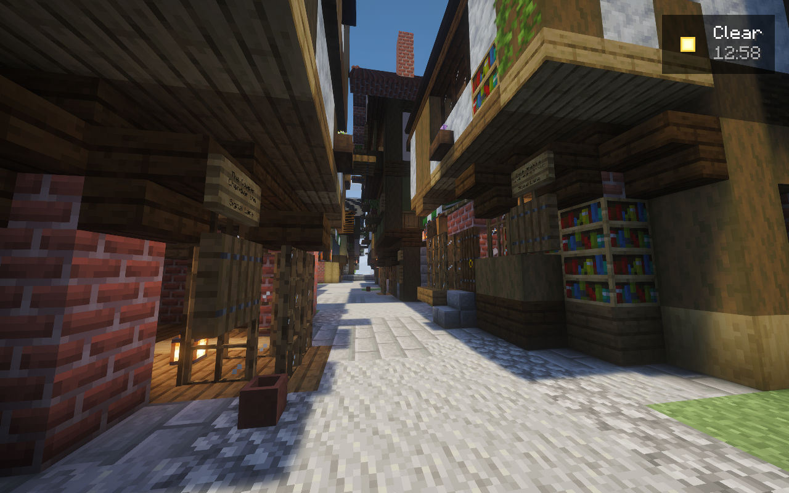
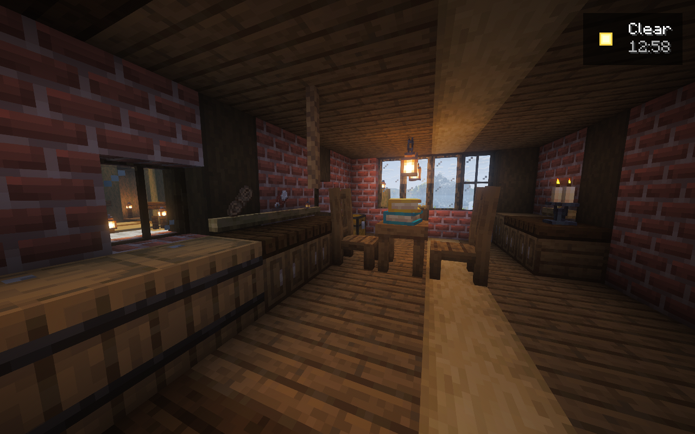
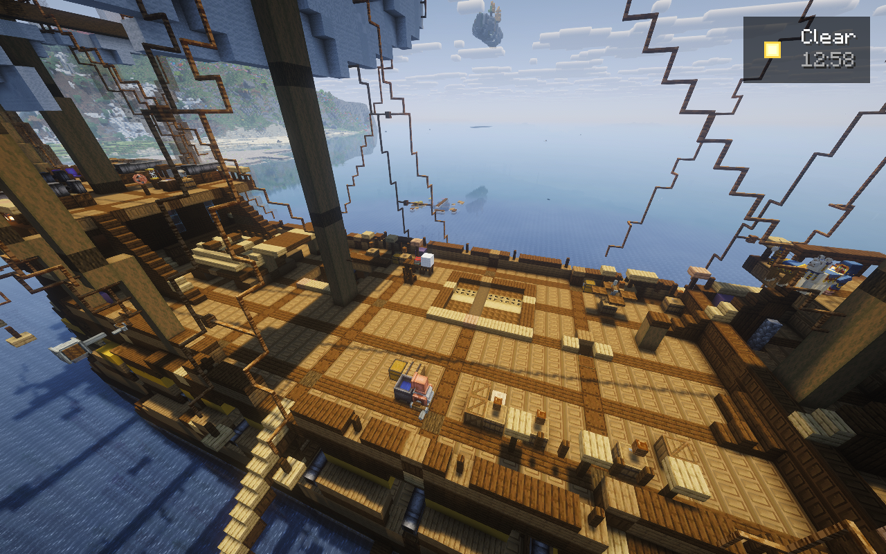
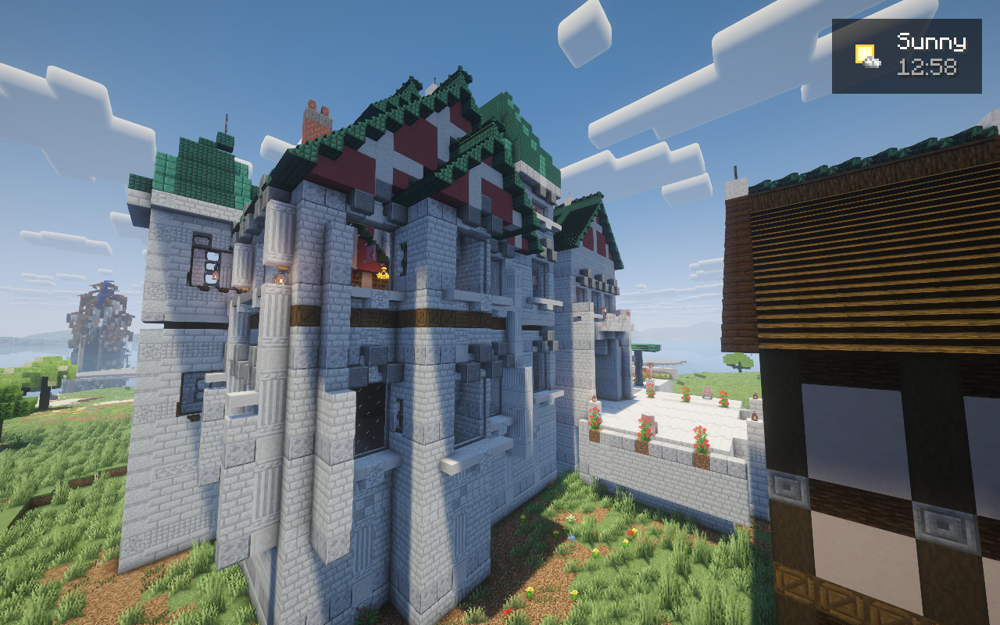
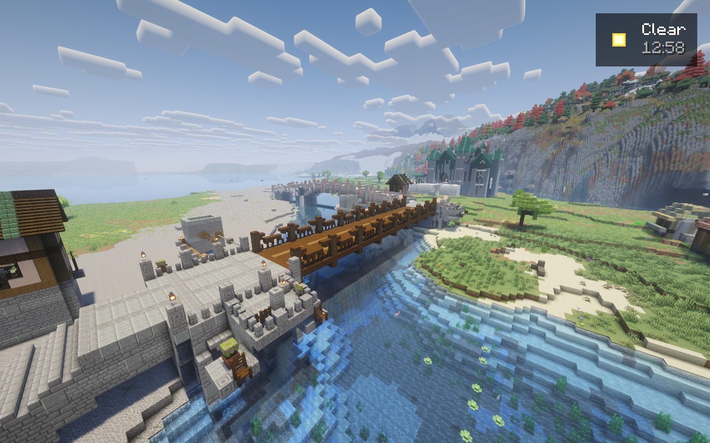

# Artistic recovery: owner-rejected settlement

On 2026-10-27, KG and Sera reported that the actual settlement failed visual
acceptance. This applies to the whole built environment, including ships,
bridges and Rosewater Castle. Native placement receipts do not override their
assessment. Earlier design documents describe intended features and historical
construction; they do not establish artistic success.

The reported failures are oversized, repetitive, boxy buildings; excessive
spacing; weak streets and landscape composition; unconvincing ships and bridges;
and an empty atmosphere. Adding decorative clutter to the same layout is not
the requested correction.

The owner subsequently authorized discarding tonight's world and player changes,
including starting over when it produces a better result. No response is expected
while the owner sleeps. Existing modpack requirements remain in force. The six-hour
working window prioritizes actual design, construction and visual iteration.

## Working method

1. Record the existing weaknesses using actual Minecraft framebuffer captures.
2. Build one authored waterfront street/cottage cluster, one complete historical
   sailing ship, one major bridge and one important castle section in an isolated
   copy using the actual modpack.
3. Inspect normal eye-level views, silhouettes, interiors and circulation. Revise
   weak proportions and composition before repeating any design.
4. Apply successful designs to the wider settlement, using recoverable checkpoints.
5. Review the complete settlement in sunlight, sunset and darkness; update the
   cinematic only after the improved environment exists and has been seen.

The staging copy is a temporary construction and visual-review environment. It is
not deployment or artistic acceptance. Screenshots must be actual game output.
Reference images, overhead map tiles, generated geometry previews and block counts
must never be presented as native screenshots or visual qualification.

## Design direction

The harbor should form a dense pedestrian town with closely grouped 6–12-block
frontages, varied 2–4-storey silhouettes, winding 3–6-block streets, 2–3-block alleys,
overhanging upper floors, enclosed courts and coherent waterfront activity.
Each building needs a purpose and usable interior. Individual footprints, roof
profiles, elevations and frontages are authored rather than repeated box templates.

The owner's two hard material rules apply to **every complete building**, including
floors, roofs and framing. An uninterrupted run of one block material may exceed
three blocks in at most one Cartesian axis, and may never exceed nine blocks in
any axis. Different facing/axis properties of the same block do not evade these
limits. Use actual structural joints, openings, dividers and distinct construction
elements. Passing this geometry check does not make an unattractive design good.

Decoration, atmosphere and small purposeful scenes must receive more design effort
than shells: fitted trade counters, stocked wall displays, household groups,
intimate courts, lamps, greenery, signs, worn thresholds and layered alleys. Use
the installed mods' actual windows, doors, roofs and furnishings. Avoid repeated
oversized soffits, dark empty rooms and isolated furniture markers.

The river, its navigation channel and the drawbridge's underspan are building
exclusion zones. Place homes and workshops on real dry banks. Piers, cutwaters,
quays and the bridge itself must have a structural reason to enter water.

Ships need fine entries, curved sections, tumblehome, sheer, appropriate transoms,
plausible rig proportions and navigable belowdecks fitted to the hull. The bridge
needs convincing structural form, shaped abutments and approaches, parapets and
water-level appeal. Preserve the harbor bascule's required 45–60° opening range.
The castle needs a composed skyline, inhabited wings, clear circulation and a
dramatic progression from town street through gatehouse to court.

## Visual review record

The required matching before/after views include spawn plaza, high street, market,
residential street, narrow alley, waterfront, tavern district, shipyard, castle
approach, castle, cottage district and an elevated panorama. A representative
ship additionally needs bow, stern, broadside, elevated three-quarter, weather
deck, captain's cabin, gun deck and lower hold views. Bridges need water, road,
shore and elevated views. Captures must record world/candidate identity, position,
view direction and lighting conditions.

Technical checks remain necessary for save integrity, valid block states, safe
spawn, working mechanisms and reasonable server cost. They are bounded support
for construction, not the focus or substitute for visual review. Artistic status
remains **owner-rejected / recovery in progress** until real visual evidence and
the owner's opportunity to assess the result support a different status.

## Overnight native review, 2026-10-27

The official server was stopped normally at 05:26 UTC. Its rejected world remains
separate from the fresh same-seed artistic staging world. Tonight's player data
was not copied into that fresh world. The temporary licensed client connects only
to the loopback staging port for captures; its QA helper is excluded from releases.

Actual shader screenshots exposed and drove the following revisions:

| Prototype | What the real view exposed | Current work |
| --- | --- | --- |
| Signal Lane | Thick boxed overhangs, small dark windows, empty shops | Broader glazing and shopfronts placed; thinner soffits, real stocked displays and lived-in scenes prepared |
| Rosewater Lark | Pale hull barcode, unstable initial rope family mix, empty working deck | Related timber joints placed; all 2,054 second-revision rope cells passed a short settled native identity check; richer deck machinery and cargo scenes prepared |
| Castle gatehouse | Flat side mass, empty archive, actual roof/wall gap | Projecting rooms, broad windows, buttresses and sealed roof joins placed; asymmetric inhabited wings and ground terraces in progress |
| Cottage court | Cozier lane, but dark and sparsely furnished entrance rooms | Furnishing and courtyard detail pass in progress |
| Harbor workshop | Repair boat read as a heavy flat canopy | Tapered open boat/trestle and roof-edge revision in progress |
| River crossings | Need clear navigation and a coherent shared road junction | Both original crossings placed without shared target collisions; moving bridge completed two native 55° cycles |

The first moving-bridge setup failed because the new radios lacked explicit native
transmitter/frequency initialization. Its receipt is retained. The four actual
radios were corrected through Create block-entity data, then real setup and two
button-driven cycles passed. No kinetic speed, angle, signal or motion was fabricated.
Restart persistence and vessel-specific passage remain separate checks.

No new artistic acceptance or completed permanent-world deployment is claimed.
The latest review deliberately rejects weak details instead of treating block
counts or a passed source check as visual success.

Selected exact native frames and their camera/hash records are in
[the sanitized evidence](../evidence/runtime/artistic-recovery-20261027.json).
These are work-in-progress views, not generated concept images or an assertion
that the owner's artistic standard has been met.

