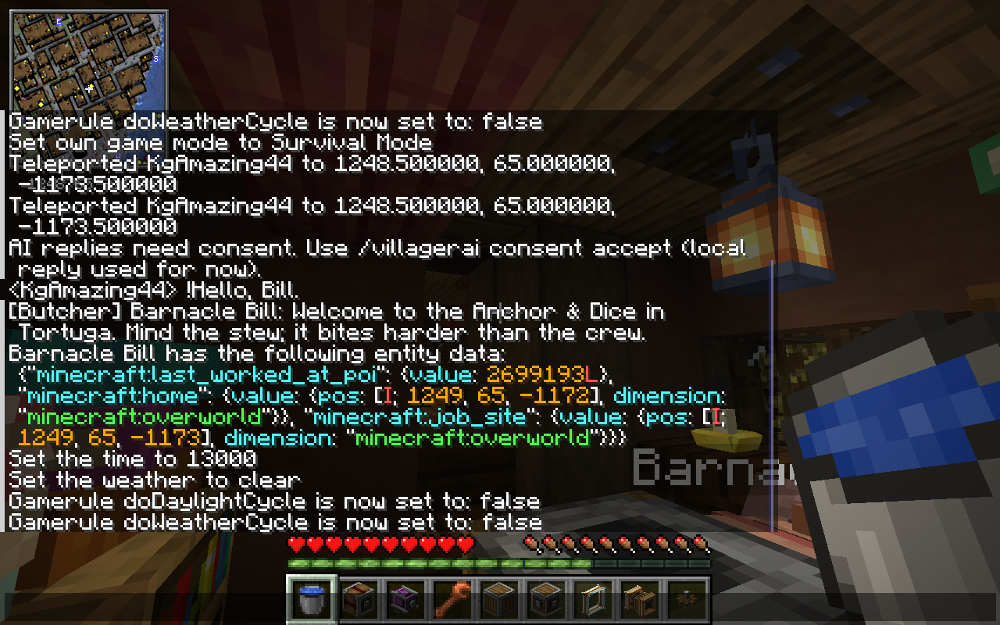

# Living World and Character Studio

**Current milestone—2026-10-29:71 villagers are actually introduced in71
unique Tortuga properties** on candidate65/bridge0.6.51. This comprises39 East
compounds,14 of36 new West properties,seven retained/refined West properties and
11 earlier baseline properties. All ten named residents are introduced and all
ten Character Studio profiles have native acknowledgments. Managed78 includes
these71 villagers plusseven prior nonvillagers; it is not a total-world census.
West36 still has22 unpopulated additions. The latest19 were introduced through
clean15+4 cohorts with ordinary AI/no native owners; their individual claims,
schedules, sleep and restart remain unqualified and they are not yet backed up.
The0d0f5a saved52/59 census predates that cohort and remains historical.

Bill’s custom dialogue, HOME/JOB, work and sleep/wake demonstration was genuinely
observed at **2026-10-29 15:26UTC**, with external AI disabled. The later0d0f5a
saved observation has no HOME/job_site memory, while retaining potential-job and
prior work/sleep/wake memories. Current Bill claims and behavior need rechecking;
the earlier demonstration does not establish current whole-population success.
See [current coordination](coordination/WORKSTREAMS.md) for the scoped records.

## Historical first Bill demonstration—2026-10-29

Barnacle Bill’s first native spawn acquired a home and smoker, worked, slept and
returned the authored greeting through normal player chat. The game acknowledged
the applied profile hash. That dated result remains evidence for this one
interaction/behavior sequence; current71-resident acceptance is separate.



Stand within a few blocks of Bill, face him, and send `!Hello, Bill.` through
ordinary Minecraft chat. His configured local dialogue works without an external
provider. External AI remains disabled; no consent setting was changed. The normal
AI-consent notice can appear while the local reply still works. A Studio preview
alone does not prove that an in-world conversation worked.

The [scoped evidence record](../evidence/living-bill-native-20261029.json) separates
actual resident behaviour from source preparation and pending acceptance.

## Use the Studio

Open Control Room and choose **Characters**, search for Barnacle Bill, and open his card.
The editor has Overview, Personality, Knowledge, Dialogue, AI & Memory, Voice,
Location and History sections. All portraits are locally rendered character icons.

1. Edit identity, freeform personality instructions, traits, speaking style and humor.
2. In Knowledge, add sourced facts, clearly fictional rumors, personal lore or unknowns.
   Secret entries never enter provider prompts. Edit shared district knowledge separately.
3. In Dialogue, add one short line per row. Empty personal categories inherit the
   district catalog. Shared district dialogue is editable without source-file changes.
4. **Save** validates and persists the registry, checks its revision against newer
   edits, and retains the previous profile in History. Revert Changes discards the
   draft. Restore Defaults is a draft until saved. Duplicate/import creates a new,
   unbound identity, with AI disabled; removing a registry profile never deletes an entity.
5. Test Conversation uses the **saved** profile. Scripted previews need no provider.
   Try Scripted Dialogue tests a selected category. Neither sends dialogue into Minecraft.
6. **Save and Apply** writes a bounded, validated runtime snapshot. The installed
   adapter watches atomic file changes, validates off the tick thread, then swaps the
   configuration on Minecraft's executor. Until its exact hash is acknowledged, the
   UI reports staged/pending. An acknowledgement for an older snapshot never claims
   a newer edit was applied. New mods require the owner's normal restart workflow.

Authored profiles start **unbound**. They do not establish that an entity has been
placed. An operator can inspect an existing entity with
`/awftcharacters inspect <entity>` and bind its returned UUID in Location. No spawn,
teleport, deletion or command execution is performed by the Studio. District bounds
must come from the owner's actual layout; unset bounds never become made-up map areas.
The district API accepts a dimension and explicit min/max X/Y/Z coordinates.

## What runs where

| Capability | Implemented behavior and qualification boundary |
| --- | --- |
| Ambient villagers | Chatting Villagers 1.1.0; 121 original district lines plus 16 two-speaker exchanges. Dynamic selection uses current personal/district data, weather/time conditions, native anti-repeat IDs and quiet global limits. Native behavior remains unqualified. |
| Named conversations | Smart Villagers 2.0.0; the adapter selects enabled, UUID-bound villager profiles. Native asynchronous HTTP and text displays are retained. Names, personality instructions and relevant approved lore are composed at the request boundary. |
| Global game AI | Studio's verified global **OpenAI** policy reaches upstream through adapter 0.2.0 after Apply. Dedicated server credentials use `SMARTVILLAGERS_API_KEY`, supplied from its environment or the encrypted Windows user store. Tested per-character model overrides use the same native transport; per-character provider changes and Anthropic remain preview scope. |
| Scripted fallback | Personal/district dialogue works without a provider. Missing consent, configuration, pricing, capacity or provider availability falls back to text. |
| Bubbles | Enabled by default. Per-character enable/disable is supported by adapter source. Native bubble distance/lifetime are global upstream settings; per-character controls are visibly unavailable. |
| Memories | Dashboard preview memory has bounded retention, correction, removal and reset. Native memory can be disabled and context is capped at eight upstream exchanges; native retention/correction UI is unavailable. Previously persisted upstream memories are not deleted merely by disabling future storage. |
| Atlas | Stable profile links, character layer, type-aware search and known-position focus. Assigned homes remain assigned; expired native samples become last known. Current presence requires the exact owned PID/start time/cwd and a fresh sample. |
| Backups | Existing world backup includes registry and staged runtime snapshot. Restore preserves the current character folder in the recovery directory before replacing saved profiles. Credentials are not in these files. |
| Voice | Optional Simple Voice Chat pin is proposed, disabled. Audible TTS and its UDP route require owner setup and a real hearing/fallback test. The current adapter leaves voice disabled. |
| Animals | Animal/custom profiles can be authored and previewed. Native animal AI is unavailable. CreaturePals is held for dependency/metadata and AI-directed entity-action conflicts; no unsupported animal is silently enabled. |

The initial characters are Barnacle Bill, Old Finn, Captain Blackthorn, Mara Keel,
Steward Pembroke, Librarian Elm, Captain Thimble, Poppy Green, Foreman Rivet and
Mercy Tide. Their backstories are authored fiction, distinct from sourced project facts.
The eight templates also include a judgmental cat and a loyal, ridiculous dog.

## Privacy, costs and resource limits

External AI starts disabled. New registries prefer GPT-6 Luna with none reasoning;
existing model choices are preserved. Configure the dedicated server credential and
verify account/model/endpoint compatibility before enabling it. Each dashboard external
test requires explicit consent; normal game chat requires upstream player consent,
and the adapter independently checks consent even for the upstream operator test path.
No large local language model is launched.
The [OpenAI setup guide](LIVING-WORLD-OPENAI.md) covers masked one-time key entry,
connection testing, model overrides, generation limits and the real gameplay sequence.
Keys never enter registry/runtime exports. Credential rotation requires a normal server
restart; stale or pre-0.2 adapters receive an AI-disabled snapshot until updated and
authenticated, followed by Apply again.

Only relevant non-secret facts/rumors are retrieved. Unknowns and forbidden topics
are excluded, and missing facts require an admission of uncertainty. Obvious unsupported
coordinate-shaped replies are refused. These guards do not prove arbitrary generated
prose true; owner review remains necessary. AI output is never a server command or action.

Retained exchanges are checked against the current topic policy before reuse. An active
personal or inherited district secret suppresses all retained history: an old response
may paraphrase information that has since become private. Setting context turns to zero
forwards no preview history. Disabling a native profile prevents new memory storage;
it does not delete historical upstream data.

Native requests have a hard cap of two concurrent calls, per-character cooldowns,
persisted hourly admission and a conservative daily cost reservation. The adapter
rechecks the exact configuration, player consent, loaded entity and proximity after
disk admission, immediately before upstream's nonblocking network call. The native
default token budget is 120 and upstream display ceiling is 180 characters. Response
budgets and supported reasoning settings follow the verified selected-model policy.
Ledger reservations are not refunded on failures. Dashboard previews, connection tests
and native game requests share the configured daily allowance under a nonblocking
cross-process lock. Limits apply to this integration; other account usage is outside it.
Administrator-entered rates are estimates, and provider billing is authoritative.

Permissions are checked again after the provider responds. A delayed reply binds the
original player object, loaded villager and configuration; delivery is cancelled before
display or memory writes if the session, configuration, dimension, proximity or required
consent changes. Logical response deadlines retain request capacity until the original
provider future finishes. Shutdown settles queued futures, including replies waiting for
Minecraft's executor, while unresolved provider calls still count against capacity after
a same-process restart. These are source/JVM checks; main-lane native tests remain required.

The ambient adapter admits at most three emissions per minute and two simultaneous
bubbles for each present potential observer, including bubbles-only output. Disjoint
audiences have independent budgets. Shared displays are suppressed if any such observer
has opted out. The audience estimate includes vanilla view scaling; later arrivals and
modified clients are outside that emission-time guarantee. Distance and lifetime remain
global native settings. Dynamic two-speaker dialogue also supplies the nonzero count
required by the upstream scheduler when its stock conversation pool is disabled.

The registry permits 64 profiles, a 1 MiB runtime export and an 8 MiB retained registry.
History retains twelve versions per profile. Preview memories are separate from authored
lore. Existing Task history may retain generated preview responses among its last fifty
jobs even when conversational memory is disabled; do not use private player information
in test prompts unnecessarily. Credentials and provider error bodies are not returned.

Profiles load on demand; display/navigation makes no AI requests. Atlas uses its existing
poller. Native telemetry checks only configured UUIDs every 300 ticks, without generating
or loading chunks. A bounded I/O worker and filesystem events handle configuration changes.
Owned writers use the AERO reserve guard and check both drives. This instruction does not
constrain other applications or pre-existing writers and is not an OS quota.

## Historical feature-branch integration contract

The feature branch starts at `3d337e4305006d4745ba6ba85c458accf54ef1f1` from
`codex/master-integration`. New feature code is in `control_room/characters.py`,
`control_room/character_atlas.py`, `living_world/`, `static/characters.*` and
`compat/living-world/`. Shared changes are narrow hooks in `web.py`, navigation,
the Atlas frontend, backup inclusion/restore and packaging `living_world*`.
There are no changes to `server.py`, the active control bridge, canonical
`catalog/*`, canonical `packwiz/**`, release channels or world saves.

The runtime contract is `awft-living-world:1` in
`dashboard/characters/runtime.json`. `registry.json` remains private dashboard state.
The adapter publishes `awft-living-world-state:1` in `native.json`, including
the config SHA-256, revision, observation time, process identity and up to 64 loaded
entity observations. Native pricing/admission reservations live in `native-budget.json`.
No API key is exported. `native.json` is telemetry, not proof of player acceptance.

All HTTP routes retain Control Room's loopback/origin/session protections. GET routes
are `/api/characters`, `/detail?id=…`, `/export?id=…`. POST operations under
`/api/characters/` are `save`, `remove`, `duplicate`, `import`, `restore`, `defaults`,
`district`, `settings`, `memory`, `preview`, `ambient` and `apply`. Mutations use
the supplied `expected` revision. Conversation previews run as existing background Jobs.

## Historical initial install and rollback handoff

1. Master reviews this branch and serializes the shared hooks with current Control Room work.
   Review every exact pin and retained exclusion in the compatibility inventory.
2. Export a fresh proposal with `python -m tools.living_world_upstream --output <new-directory>`.
   It refuses overwrites and writes no world. Build the owned addon with Java 21:

   ```powershell
   python -m tools.build_living_world --home <existing-compile-home> --dependencies <verified-author-jars> --output <fresh-owned-addon.jar>
   ```

   Compiler APIs are read only; this does not install the addon. Never commit downloaded JARs.
3. Master retains a verified backup, creates a private matching candidate containing the
   two native mods, adapter and proposed defaults, then regenerates Packwiz's complete
   hash chain. Keep voice/animal AI off. Preserve any existing stock/custom dialogue
   before disabling overlapping pools. Install client-side files as specified by the
   exact author metadata; an advertised loader match is not a compatibility result.
4. Under a coordinated runtime window with the owner's EULA/account authority, bind
   actual NPC UUIDs, set measured district bounds and apply the snapshot. Check its exact
   acknowledgement, then test edited dialogue in game and again after a normal restart.
5. Test two real players, simultaneous different-NPC chats, bubbles/overlap, trading,
   jobs/movement, unloaded chunks, disconnects, consent, provider failures/timeouts and
   crowded areas. Measure real server CPU/RSS/MSPT, response latency and network behavior.
6. Roll back through the master's existing candidate/config backup workflow. Restore the
   prior registry from History or a verified world backup; retain the newer registry and
   failed receipts. A profile removal is not entity deletion. Publish no unqualified pack.

## Historical source qualifications and original acceptance backlog

The records and pending-work language below describe their named historical
source checkpoints. They are preserved rather than rewritten and do not
supersede the current71-resident milestone above.

The OpenAI extension and editable-model correction are recorded in
[the 0.2.0 source receipt](../evidence/living-world/openai-qualification.json).
Its key security, model policies, shared allowance, HTTP and JVM checks pass; actual
Minecraft installation and the one-villager demonstration still need the master's
execution window. Read [OpenAI setup](LIVING-WORLD-OPENAI.md) for the secure owner flow.

The latest integrated source results are recorded in
[the integration receipt](../evidence/living-world/integration-qualification.json).
This branch includes main-lane commit `26f1cfb`, which restores its frozen construction
dependencies. The full local suite now passes: **1,173 tests, zero errors, one platform
skip**. The identical source tree passed PR-merge CI with three platform/input skips.
The Living World implementation and corrected addon inputs did not change in that merge.

[The correction receipt](../evidence/living-world/correction-qualification.json) preserves
the prior source checks and missing-module failures before the committed main repair.
The original receipt and binary below are historical and **held**: subsequent review
found missing ambient scheduler activation, bubbles-only rate admission, stale history,
delayed-reply and shutdown ownership defects. Use only the corrected source candidate
identified by these receipts for the main lane's private runtime qualification.

At the previous source checkpoint, focused registry, HTTP, backup, frontend,
upstream-schema and JVM checks passed. That full suite ran 1,137 tests with three import errors and one skip: the
starting commit references absent `tools/artistic_tortuga_coast_batches.py` and
`tools/artistic_tortuga_west_approved_blocks.py` through three unchanged artistic tests.
Both modules were already absent at base `3d337e4`;
this lane does not copy the main owner's uncommitted construction work to hide the gap.

[The historical qualification receipt](../evidence/living-world/qualification.json) preserves that superseded build and checks.

A real NeoForge loader probe discovered all three mods, retained `eula=false`, exited
at the EULA refusal and created no world. No target classes were exported by Mixin
before that refusal. It therefore proves discovery, not Mixin application, native
startup, in-game dialogue or coexistence. The reproducible bounded probe is retained
under `proposals/living-world/mods/probes/loader_probe.py`.

Actual isolated browser checks saved Barnacle Bill's speaking style and a custom joke,
ran a scripted conversation and reproduced the saved joke through ambient preview.
An early warm development preview measured 24 loopback summary/detail requests: median
15.144 ms, p95 27.106 ms, RSS 39,424,000 → 39,624,704 bytes and 0.0469 CPU seconds over
0.3585 seconds. Its source was still changing; this is a scoped dashboard observation,
not final-head feature overhead, a sustained benchmark, or Minecraft performance.

Real in-game end-to-end, restart persistence, two-player synchronization, external-provider
responses and server performance remain **NOT RUN**. They require the coordinated owner
window and provider configuration/consent. Source completion and a draft PR do not satisfy
those acceptance criteria. Full upstream/dependency findings are in
[the compatibility record](LIVING-WORLD-COMPATIBILITY.md).


Actual browser capture; this does not establish in-game or final-head browser acceptance.

The owner selected the **main development lane** to coordinate and execute the remaining
in-game tests. Exact-head [CI run 40776960802](https://github.com/Kgray44/a-world-for-two/actions/runs/40776960802)
confirmed the same three inherited import errors (1,137 tests, three platform/input skips).
No source check was bypassed. A subsequent browser check at that source checkpoint reloaded the saved
joke after a dashboard restart, reproduced it in ambient preview, checked visibly disabled
unsupported bubble controls and checked the 390 × 844 mobile breakpoint without document
overflow. The temporary viewport was restored.


