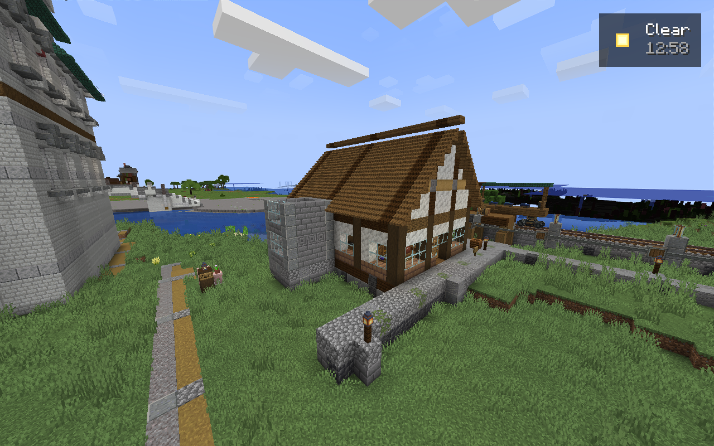
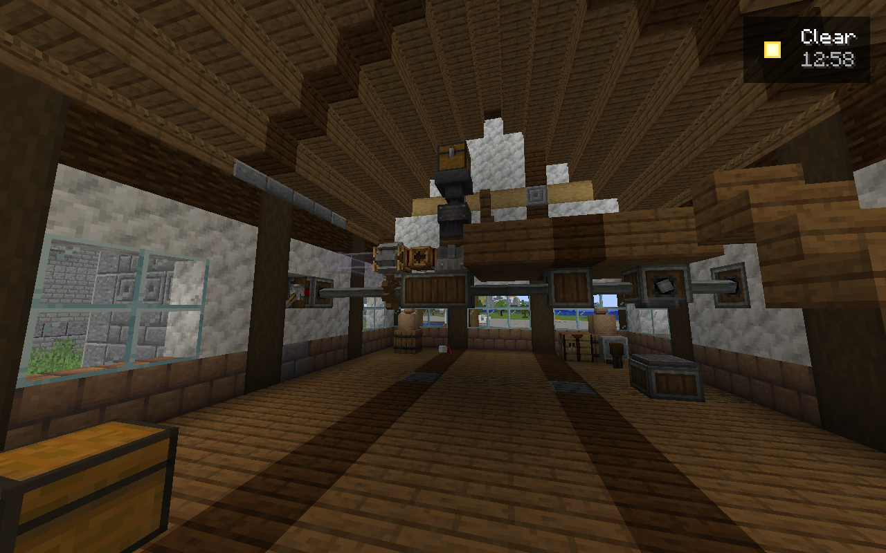
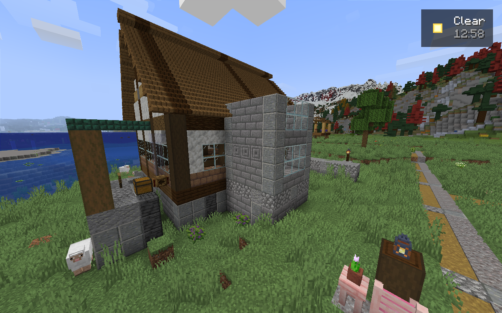

# Candidate 35: isolated native results

Candidate 35 keeps the gameplay pins unchanged and adds an explicit private
registry diagnostic and bounded mill commissioning. It is not a new public Prism
release or an artistic acceptance. The official server/save was not changed.

The paired dedicated server and signed-in client started and connected normally.
Both then stopped normally; no owned test JVM remained. The client used its
requested 6 GiB heap and temporarily disabled shaders for this diagnostic run.
These are startup and integration results, not travel or graphics benchmarks.

## Terrain diagnosis

The actual cached client registries and actual server registries have identical
sets of 1,950 fingerprint keys and identical encodings for all 248 density
functions. Both private exports completed without encoding errors. Only the
Overworld and Nether noise settings differ.

The server has Lithostitched's transient surface-rule merge, whose original
surface source exactly equals the client's unmerged source. The Overworld also
has Lithostitched's merged fluid-floodedness router field. The missing native
client setup phases must be reproduced; ignoring those fields or fabricating a
matching fingerprint would leave the actual generation mismatch unresolved.
SeedGen's strict comparison remains active and refuses local generation.

## Mill operation and appearance

Current native dry geometry verification passed. Commissioning initialized the
real kinetic components and track graph, then stopped at the station readiness
gate. It added no water or tube connections, transferred no demonstration goods,
and created no train. Temporary tickets and the shared lease were released.
The failure receipt is retained. This is not a functional mill acceptance.

The actual first R2 images also failed the agent's visual review: the ridge has
a gap, roof planes are too plain, principal windows use ordinary glass, the hall
is dark and sparse, and the wheelhouse reads as a box. A separate R3 architectural
revision is being prepared and must be applied and seen before any finish claim.

The [sanitized result record](../evidence/artistic-candidate35.json) binds the
native export and image hashes. Full worldgen encodings remain private. The
parent run passed 346 Python tests, all 207 Packwiz records, four session tests
and both dashboard JavaScript syntax checks. These support source correctness;
they do not establish finished artwork or owner acceptance.
