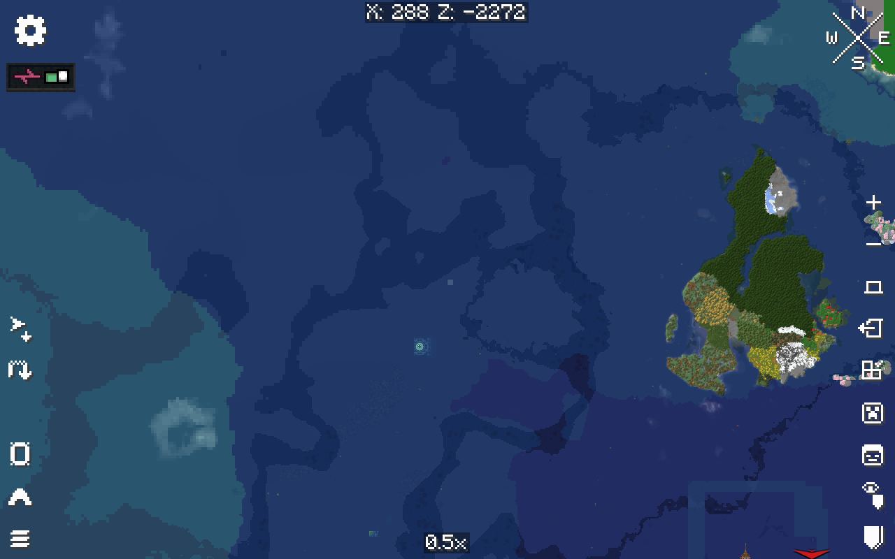

# Native mapping and empty-world commissioning

These are private candidate 36/37 results. The public Prism release remains
candidate 31, and the official world was not changed by these tests.

Candidate 36 starts the real dedicated server and authenticated client with the
reviewed MapHorizons awft.2 repair. The actual Xaero World Map opens, pans to the
requested Overworld coordinates, converges to the requested zoom and supplies
two agreeing rendered frames for the capture below. This proves native UI and
full-resolution DH data interoperability. It does **not** prove coarse-only
SeedGen LOD rendering, every dimension or party privacy. The existing DH database
contained no verified coarse-only test region; fine data was not removed to
manufacture one. SeedGen's strict generation check still refuses parity.

The mill's original dry placement and track graph were valid. Candidate 36
observed real graph locations and directions but unattached station points,
including after a player loaded both station chunks and disconnected. The pinned
NeoForge server's native empty-world branch explains this: after 300 empty ticks,
entity and block-entity ticking stops unless players or saved forced chunks keep
the branch eligible. A temporary distance-manager ticket alone does not satisfy
that separate saved-forced check. Loaded holders and range readiness therefore
do not prove that block entities are executing.

Candidate 37 calls Minecraft's normal `resetEmptyTime()` only while the admitted,
finite, zero-player mill commissioning operation owns its shared lease. Idle,
read-only inspection and cleanup states do not wake the dimension. No permanent
forced chunks or global idle setting were added. Native commissioning then
attached **both** stations to their real track graph, confirming that diagnosis.

The same attempt stopped at the first Hypertube connection-face guard. It left
no tube links, added no water, fed no demonstration items and created no train.
Temporary tickets and the shared lease were released. The occupied/unsupported
face is being investigated against the exact addon API before another attempt.
Station attachment is proved; successful mill processing and passenger transport
remain open.

The [sanitized native record](../evidence/artistic-candidate36-37.json) binds exact
artifact, image and terminal-receipt hashes. The separate
[R3 architectural finish](ARTISTIC-MILL-DETAIL.md) still requires native placement
and actual visual review. Neither source material-run checks nor a successful
station initialization establishes artistic acceptance.
