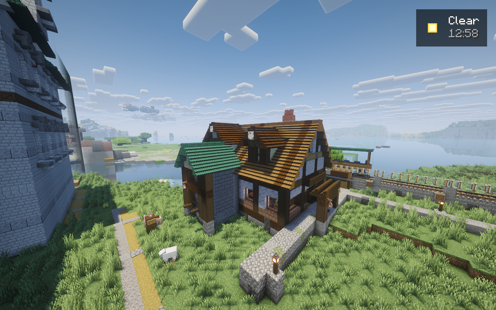
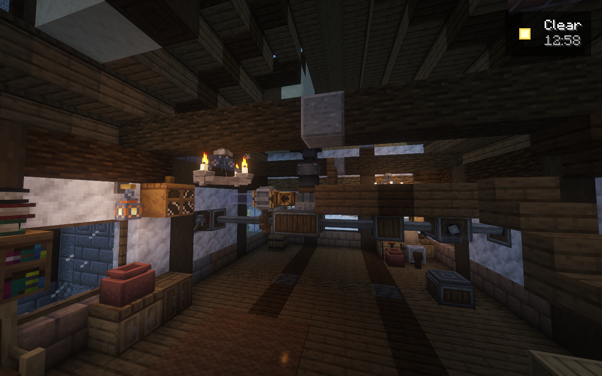
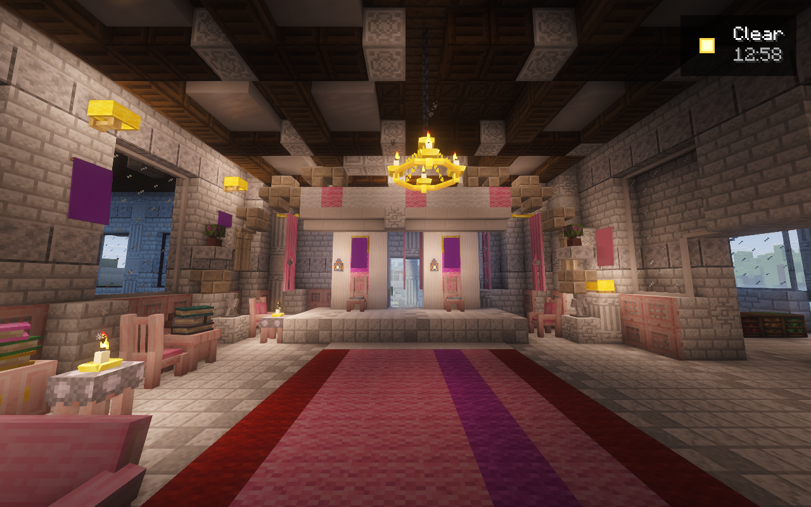
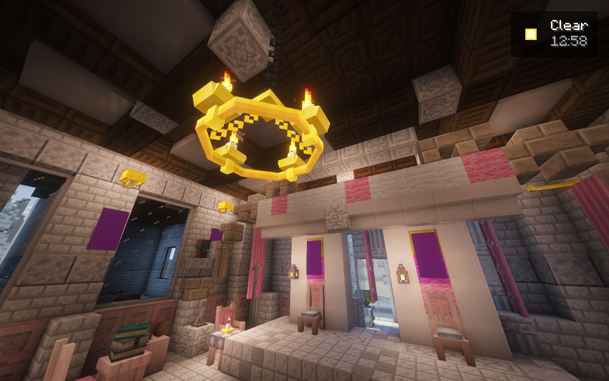

# Private candidate 38 native results

These results belong to the owned artistic stage, with bridge **0.6.24** and
unchanged gameplay pins. The official world and public candidate.31 release were
not upgraded. No fresh public import or complete multiplayer acceptance is claimed.

The dedicated server and authenticated 6 GiB client started and joined normally.
The native idle-simulation getter linked on all three dimensions. With no players
or saved forced chunks, the observed empty-world timer correctly suspended the
entity/block-entity branch; loaded chunk counts alone do not establish simulation.
This telemetry never wakes a dimension. The bounded mill commissioning lease
separately permits the real native initialization it needs.

## Furnished mill and transport

An exact two-block entrance-facing correction permits both Create stations and
all six native Hypertube connections, including their real collision filler
ownership. Water was admitted. Commissioning then stopped because the native
locked/manual entrance requires a real detector attachment. The drive is stopped;
no wheat processing, passenger travel or train run is claimed. Partial native
connections remain saved. Replaying the initial commission is prohibited.

The mill received its R3 roof, framed windows, wheelhouse, lighting and furnishings.
The first strict verification retained 63 native-derived window/ridge part
differences. Correcting those expectations from the actual pinned mod algorithms
allowed **516/516** targets to pass without another placement or weakened verifier.

## Castle and drawbridge

The castle audience room now has shaped arches, coffered ceilings, rose curtains,
books and tea alcoves. The native **240/240** target verification passed.

The fixed bridge banks, cutwaters and control towers were placed independently.
An initial 32-window-part mismatch is retained; corrected native-derived part
expectations then passed **2,775/2,775** targets. The old closed moving spans and
their actual saved glue remain unchanged. The refined moving leaves require exact
owned-glue retirement, full verification, two genuine 55-degree button-driven
cycles and a restart without another setup. Tower appearance also remains open
for further artistic refinement.

All images are unchanged native Minecraft captures with Complementary Reimagined.
They are agent visual review, not owner acceptance. Point FPS readings in capture
metadata are not a travel or multiplayer benchmark.

## Retained evidence

[Sanitized native record](../evidence/artistic-candidate38.json) binds the artifact,
plans, terminal receipts and image hashes. All original failed native receipts,
unique checkpoints and partial states remain private and preserved.
The stopped post-review checkpoint is `20261027T173710Z-180512`, SHA256
`0f4b7ed90819e24f2a865ce6b1a61d14249576445662fd55bd6fbcefec0ae8f7`.

The frozen bridge suite passed 355 Python tests; subsequent art-source runs passed
370 and then 383, alongside 207-entry Packwiz validation and JavaScript syntax.
Strict SeedGen parity, actual coarse-only map coverage, complete mill operation,
new pirate-spit construction, the two requested imported builds and the final
habitat/population pass remain open. The final population pass follows completed
construction and commissioning.
