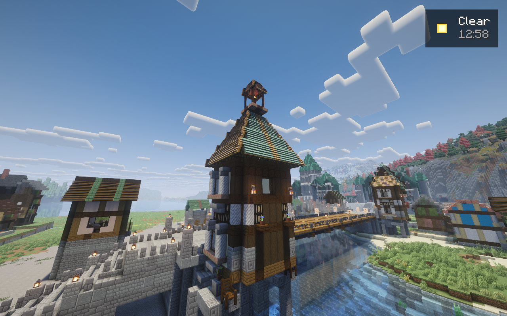
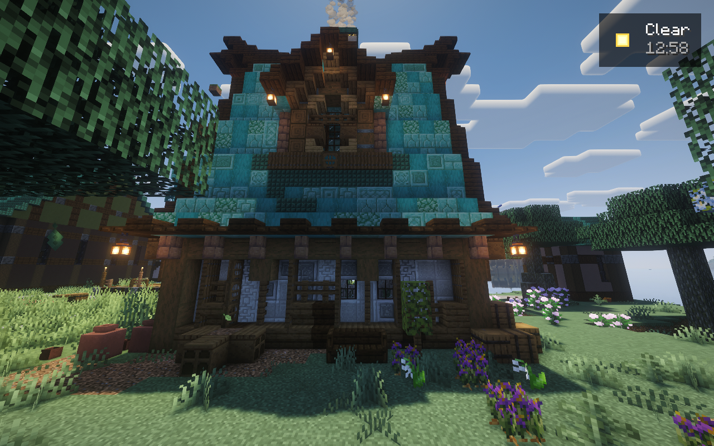
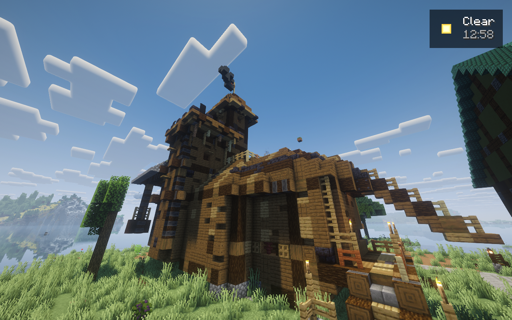
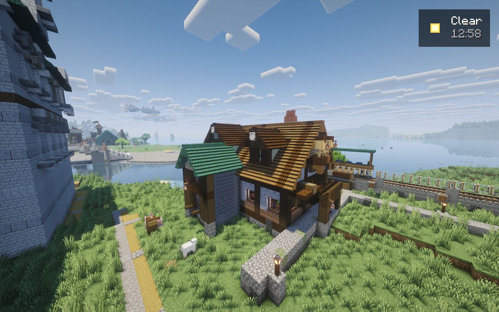
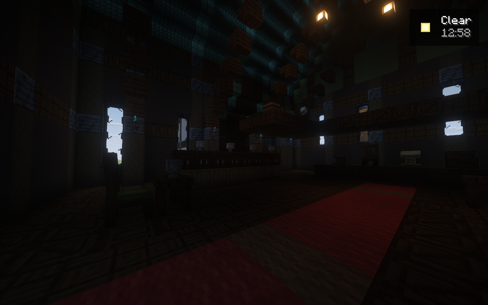

# Native bridge, pirate spit and architectural depth review

Candidates 39–41 were tested in the separate artistic world. Candidate 41 uses
bridge 0.6.27; it is a private build, separate from published candidate 31. The official
server remains offline and its saved world has not received these later changes.

The redesigned drawbridge completed two real button/radio-driven 55° cycles in
candidate 39 and another two after a candidate 40 restart, without repeating setup.
Its thin leaves keep the river open. The candidate 41 tower pass adds steep copper
hips, an open cupola, projecting bays, layered cornices and supported corners.
Normal native neighbor updates and complete physical verification passed.
Vessel passage and grounded player circulation remain separate checks.

The pirate extension follows the actual dry spit through its seaward end. Its
original gothic tavern, netmaker, pilot shelter and connected lanes are built.
The exact requested Pirate Tavern and Fisherman's Shop are now placed too,
retaining original architectural identity, legacy head/banner data where present,
and native connections. The import reconciliation checked every supplied state
and block entity after normal neighbor updates; inventories were not replayed.
Source entities remain deferred to the final habitat pass.

Architectural depth now includes recessed niches and ceiling ribs in the three
neighborhoods, five castle oriels and lodge hoods, the mill's accessible balcony,
restrained bridge fascia recesses, and independent maritime room details. Native
delta verification passed. Complete neighborhood verification exposed inherited
Macaw ridge expectations; canonical complete-neighbor corrections are prepared
but not yet natively reconciled. A failed harbor craft inspection retained its
strict entity-custody refusal, and eight optional water-side ornaments were
excluded. Neither result is disguised as a pass.

The main original gothic tavern needs another artistic correction. Actual photos
show attractive vaulted ribs above a dark, underfurnished hall. Low warm fixtures,
intimate seating and serving scenes, and a deeper barback are being authored.
Increasing source placement counts does not resolve that visible deficiency.

All five images are unchanged actual Minecraft framebuffers with Complementary
Reimagined. The test-only capture helper is excluded from release. Spectator
camera poses do not prove a walkable route; captured FPS is not a benchmark.
Exact source/artifact hashes, native receipts, preserved failures and image hashes
are in [the candidate41 record](../evidence/runtime/artistic-native-candidate.41.json).

Both private JVMs shut down normally after the capture window. The retained
checkpoint is 20261027T191930Z-f306da, SHA256
`8efabed7d75aa02015ed2165ebb249c36da6e301dfd3ef8c971f0e20c9de4f5c`.
No final LIFE pass has run. The entire south bank is being planned as varied
woodland with protected routes, views and habitat-based wildlife. The starting
plaza's new ornate working fountain is also pending construction and native
operation checks.

Mill detector attachments and full commissioning, strict SeedGen parity, the
complete inhabited landscape, a clean public Prism import and the final tested
official upgrade/release remain open. Published candidate 31 stays immutable.

The source verification run passed 446 Python tests in 60.588 seconds, Packwiz's
207-entry integrity check and JavaScript syntax checking. This is separate from
native art, physics, gameplay and release acceptance.
