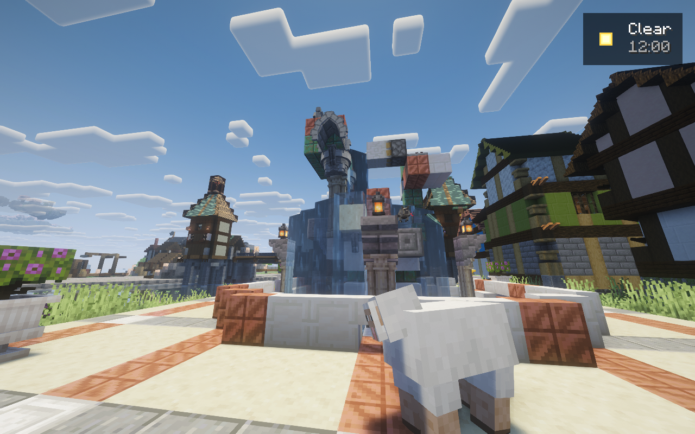
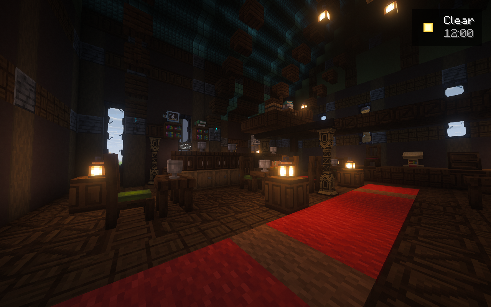
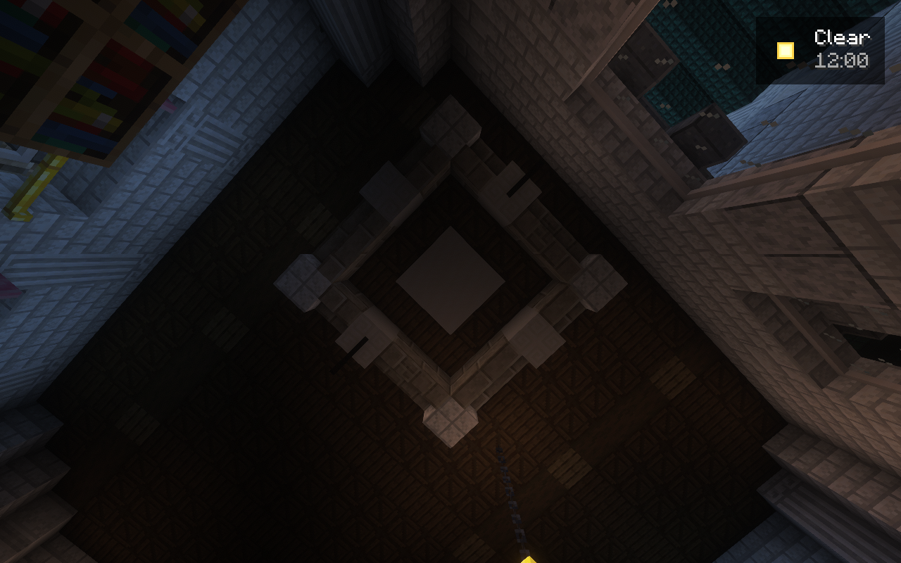

# Native candidate 42: fountain prototype and inhabited rooms

Candidate 42 and bridge 0.6.28 start the private dedicated server and authenticate
the normal KG client. Published candidate 31 and the offline official world are
unchanged. This is an intermediate native review, with unfinished work recorded
below.

The new plaza is installed on actual saved dry ground. Its fountain uses a real
Create waterwheel, cog drive, pump and pipe network to fill an elevated header.
The native test observed **−8 RPM at the wheel, +8 RPM at the pump**, no overstress,
an actual header source and water at all four cascade witnesses. Only the separate
wheel-feed source was seeded; header water and kinetic or fluid NBT were never
fabricated. Gravity supplies the cascades once the header fills. The pump normally
backpressures against that full source; continuous hydraulic circulation is not
claimed.

The complete shutoff cycle **failed**. Actual wire strength was 15, 14 and 13,
while the north-facing repeater stayed unpowered and the piston remained
retracted. The pinned vanilla input semantics confirm that the repeater needs to
face south. That source-only correction is prepared and awaits a new native test.
The earlier zero-RPM result was a separate physical defect: water spilled down
both wheel faces. A full baffle isolated one fall and restored the actual drive.
Both failed terminals remain preserved.

This photograph also identifies an artistic failure to correct: broad curtains
hide the stonework, and the isolated lancet crest and exposed pipe arm do not form
a cohesive centerpiece. The next design uses a deliberate central statue, layered
bowls, restrained complementary materials, contained narrow outlets and plumbing
integrated into the ornament. More placements alone would not solve this.

The Drowned Rose now has intimate seating, a deeper barback, actual meal and drink
displays, readable notices and lower warm lamps. Native placement, normal neighbor
settling and supplied furnishing verification passed without replaying existing
inventories. The matched bar view is visibly clearer and warmer; walking, seating
and owner acceptance remain separate.

Three secondary palace ceilings and two smaller bridge-lodge rear facades also
received real relief. All five groups passed native checks. The gallery view
shows attached ceiling members below its previous flat floor underside.

Complete Signal Lane, cottage court and Bramble Lane snapshots passed strict
verification after normal native roof reconciliation. Court's later craft-lane
supports/path edges and Bramble's retained natural vines needed explicit source
composition updates. Those updates were independently proven from exact authored
inputs and the stopped save. No general AIR exemption, vegetation clearing,
geometry replay or inventory replay was used.

## Distant terrain and performance evidence

The complete guarded Lithostitched/SeedGen orchestration is activated privately.
Its client modded-registry attempts refuse a raw Cristellib metadata path with an
uppercase filename that the actual native pack reader cannot open. The proposal
for the next candidate will attest those exact raw bytes and native unreadability;
it must preserve missing-valid-resource refusals, original order and all strict
generation gates. Local SeedGen generation is not qualified.

The real server exported all 1,950 selected codec inputs, including 255 encoded
values, in 71 ms. Its effective-state export took 94 ms and produced 1.52 MB, with
29 explicitly unknown effective states. The owner-thread custody recheck passed;
this does **not** prove full semantic parity or terrain correctness. These are
diagnostic timings, separate from gameplay benchmarks. Raw seed-bearing effective
outputs remain private.

The host was under memory pressure during the paired run. A reversible trim of
selected desktop-app working sets increased available RAM from about 4.37 to
6.51 GiB without closing applications or trimming Minecraft. The loaded client
later used about 7.6 GiB RSS despite its 6 GiB heap limit. Captured frame FPS is a
point observation, not a frame-pacing or final performance benchmark.

## Forest and remaining work

No final tree or LIFE seeding has run. The required forest covers the entire south
shore along the river and inland to the southern cliff foot, with substantial
undergrowth and winding nature walks. Default planting now favors native saplings
and normal growth; custom trees are reserved for exceptional, visually reviewed
landmarks. The earlier manual-tree proposal is historical.

Expanded saved-terrain analysis preserves unknown southern and western areas.
Its two finite survey requests must be completed before those areas receive
planting authority. The one-metre route checks distinguish the actual bank from
dry land across the river. See [the expanded geography](EXPANDED-SOUTH-FOREST-GEOGRAPHY.md).

The owned watchdog requested normal client quit and private-server shutdown at
20:40:20 UTC. Both native processes closed. The retained stopped checkpoint is
`20261027T204224Z-012e63`, SHA256
`ac863a5f04dd91ca88494c59ed27f138b0b87fdaefea45707b3c55e688365c05`.
The last south-lodge camera timed out; the night fountain view and client effective
export were not reached before the window ended. No substitute evidence is used.

The source run passed **513 Python tests in 46.988 seconds**, Packwiz's 207-entry
integrity check and JavaScript syntax checking. Native art, controls, tree growth,
LIFE behavior, Create attractions, SeedGen parity, the clean Prism import and the
final official release retain their own acceptance requirements.

[Exact candidate 42 receipts and image provenance](../evidence/runtime/artistic-native-candidate.42.json).
