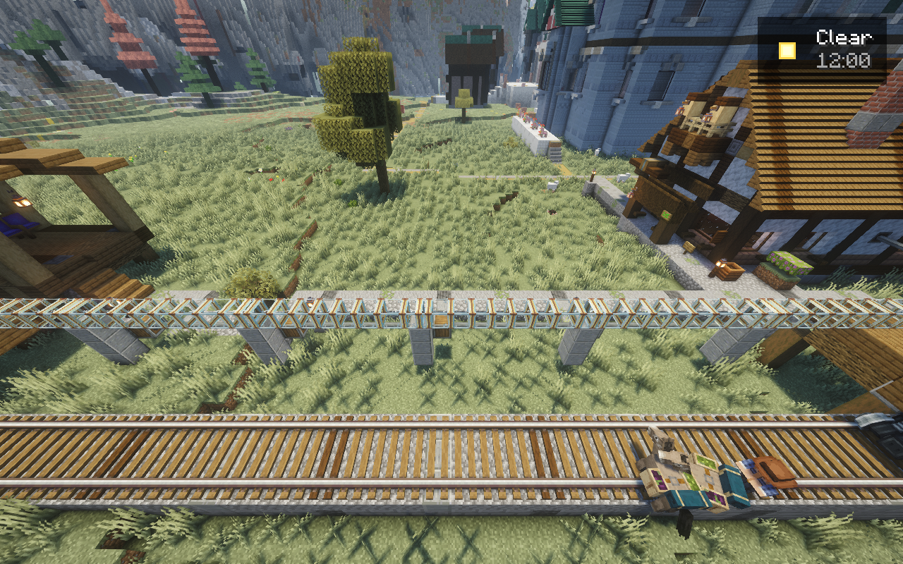
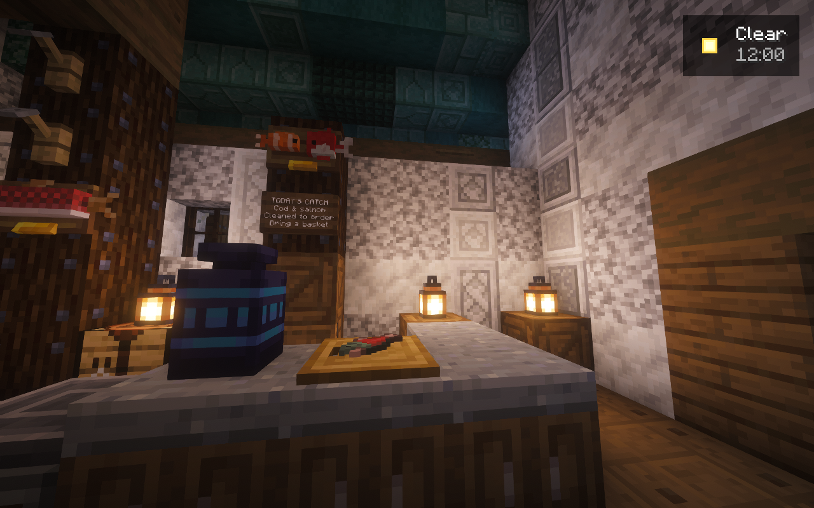

# Private candidate.48: native work and remaining acceptance

This record covers the owned artistic preview on 2026-10-28. Public candidate.31
remains an immutable prerelease. The permanent/public world was not replaced,
and this private work has not been published as a finished client release.

## Build and source checks

Minecraft 1.21.1, NeoForge 21.1.262 and Java 21 remain pinned. Candidate.48 uses
bridge 0.6.34: 584,264 bytes, SHA-256
`071fe778b27c9450c6a9a7b602825ee2ff19bfcdba9f23ba3cb24302bd6b4b1d`.
The private pack manifest is
`0e5775d8d22771e97b34b5b9f508af7baf001e6371d80588315ef08261eeed0b`.
The lock contains 208 files; default-enabled mods remain 198 total, 192 client,
165 server, with Essential disabled. These are current development counts.

The source suite completed 911 tests in 102.480 seconds: 910 passed and one
Windows real-symlink fixture was skipped. Packwiz validation reported 208 entries
and no errors; Control Room JavaScript syntax checking passed. Subsequent
release-excluded camera readiness work has its own exact-JAR API compilation
and standalone readiness fixtures. Source/API results do not establish native
artistic, performance, multiplayer or public-import acceptance.

## Native changes observed

Candidate.48 reached server readiness and accepted the licensed owner client.
The private server keeps its separate loopback game port. Client QA never
authenticates accounts, fabricates an offline player or opens a public tunnel.

The retained drawbridge receivers passed a separate normal lifecycle repair
with 40 stable observations, no button pulse and no frequency/program/glue
rewrite. The currently ornamented spans then completed two actual native
button-driven open/close cycles at 55°. Restart persistence, vessel clearance,
player use and the final visual review remain separate checks. See the earlier
[candidate.47 record](NATIVE-CANDIDATE47.md) for the preserved radio failure.

The fountain retained its native wet configuration while 26 carved details
were added. Fresh target/mount checks and the complete 2,532-position wet
composition passed after ordinary neighbor settlement. Candidate.47's real
pumped header fill, four cascades, STOP/drain and reopen are historical functional
evidence for the revised body. Current post-ornament restart/operation and the
complete centerpiece's artistic acceptance remain open.

Actual north-bank work includes the three-frontage entry/depth corrections;
the western smith and merchant with six furnished scenes; a compact two-house
headland cluster; an eastern Seabird façade/roof correction; and a second eastern
cluster with three reshaped houses, a furnished two-level mender, repair court,
produce arcade and hooked lanes. The imported fisherman shop now has its floor,
loft access and furnishing phase placed. Native target/support, placement,
neighbor settlement and full composition checks are retained for each batch.
The imported exterior and existing household storage were not replayed.
Exact saved typed-inventory preservation, usable furniture/stairs and visual
inspection remain additional checks.

The entire north bank still needs the same dense Tortuga treatment. Existing
bright, repetitive extensions remain rejected; these first corrections do not
qualify the rest. Screenshots of the hall identified broad plain exterior areas
and open ground that still need work. Native-frame captures taken before client
terrain finished displaying are retained as failed visual evidence. QA 0.1.8 now
requires native client chunks around both camera and target, followed by rendered
frames, rather than accepting Distant Horizons terrain alone. QA stays excluded
from release manifests and has no custom world renderer.

## Southern planting and living LIFE

Fourteen additional saplings grew through ordinary native APIs in candidate.48.
Two other plots remain held: one complete-state preimage refusal and one native
before-field mismatch. Neither was retried or replaced with a hand-built tree.
An initial freshness refusal left seven later requests undispatched; those
unperformed requests were subsequently run only with fresh empty-server proof.
The original refusal records remain intact. Tree silhouette, ecology, ordinary
occupant behavior and saved persistence still require their own review.

Three sectors placed 3,284 new undergrowth and vine states, followed by normal
neighbor settlement, complete after-field and retained-soil verification. A
fourth 396-state sector failed its native before check and was not placed.
The proposed 80-metre natural walking loop also passed its 928-position native
support/headroom check; this is not a native player-walk or full forest-coverage
claim. The complete south shore to the cliff foot remains the target.

Seven curated animals and small creatures passed individual ordinary spawn and
position hooks, then were added with real identities and normal AI flags. The
native terminal records seven additions, zero failures and successful cleanup.
Day/night behavior, visual review, persistence, breeding and performance remain
unqualified. The firefly stays held for a genuine dark habitat; it was not forced
through daytime spawn rules. No villagers were inferred from decorative beds.
Future residents need actual HOME/job POIs and usable routes.

## Recovery and limitations

The failed tree09 attempt's owned root cells were already restored. Independent
review of all 29,160 cells found only two unowned water/ice phase changes outside
the write envelope. The exact original quarantine and failed receipts were
preserved in a parent-reviewed recovery folder. No world rollback, extra growth
attempt or restoration of those ambient cells occurred. Candidate.48 adds an
immediate full-state pre-mutation check while retaining the existing restoration,
scope and quarantine rules.

A western path batch failed before any placement: six saved gravel columns
were AIR in the native world. The saved vertical stacks contained unsupported
gravel above water, consistent with falling-material risk; the actual falling
events were not observed. The source is preserved and a separate stable-ground
route is being prepared. This failure was not hidden by changing expected states.

Strict SeedGen parity still fails on the unrecognized Moonlight generated-pack
provider after the earlier exact YUNG provider repair. DH server LOD downloads
remain the fallback. No fingerprint rule was relaxed. Whole-town artistic
acceptance, dense full-shore woodland, transport and fleet commissioning,
current two-player/travel/shader benchmarks, clean public Prism import and final
release remain outstanding. Useful recovery evidence is retained; cleanup follows
completion rather than deleting unfinished work or failed receipts.

## Later 48 checkpoint and expanded owner criteria

The four-building Quill cluster is now placed with 9 furnished scenes and a short
70-column alley beside 326 main building-floor columns. A separate 821-target
western connection uses stable ground and a short supported timber crossing; it
does not replay the failed 868-target plan or fill its water/gravel gap. Native
placement, normal settlement and complete composition checks passed. These
figures describe those small batches, not full-bank coverage or artistic approval.

A normal server stop and retained checkpoint 06e1e7 now include the new buildings,
14 tree outcomes, 3,284 planted states and seven living additions. The archive is
243,170,766 bytes with 665 source files and SHA-256
`b0315f548e55a389bb01a3caeb4c5a8532abb3e6599f6a0a77785c6c4916dece`.
No older checkpoints were pruned.

The owner subsequently raised the target: a genuine urban re-layout across the
entire north bank, varied short/long/wide building footprints packed to the
shore, trees roughly every 4–5m across the full eligible southern land extending
east to match the north land edge, many thousands of greenery placements and
several thousand normal living creatures. The small current LIFE cohort and
sparse current tree outcomes do not satisfy that expanded scope. New dense-tree
and population-scale proposals remain separately qualified before deployment.

These two images are unchanged native 48 captures with the release-excluded
QA 0.1.8 helper. Native client chunks around the actor/target were present; the
image hashes and limits are recorded in the sanitized evidence. The tube image
shows installed links, not completed passenger travel. The fisherman image
shows the new counter and preparation area, not complete interior/player-use
acceptance. Other close/colliding camera views remain unsuitable for assessing
the entire exterior or fountain and are not presented as successful art review.
