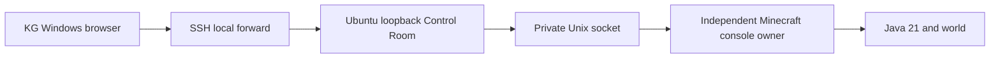

# Operation Snowfall

Migration infrastructure and future owner-run instructions. **Preparation does not
authorize moving or activating the permanent server.** No world or Snow host was
used for this implementation. Build It! retains integration and world ownership.
The master must resolve final promotion of the construction save to the configured
permanent save before selecting any migration source; they are distinct saves.

## Services and security

Windows keeps its existing dashboard-owned Java child. Dedicated Ubuntu uses the
same application with two nonroot services:



The supervisor retains Java stdin/output across dashboard restarts. Its private
directory is 0700, socket 0600, and Linux peer credentials must match the dedicated
UID. Only fixed RPC operations, existing bounded dedicated controls and the
existing console allowlist are exposed. No browser shell, RCON, public admin
listener or authentication bypass is added. Missing supervisor connectivity means
**unknown**, never offline: mutating controls fail closed.

A supervisor lease prevents competing owners. Java inherits a separate writer
lease, preventing a replacement while a surviving managed process owns it. PID
recovery still checks actual birth time, command and working directory. Following
a supervisor crash, another process cannot adopt the old stdin: a surviving Java
identity remains unmanaged and duplicate start is refused. Inspect the journal
and stop/recover the exact owned service deliberately; never delete lock files or
kill unidentified Java processes. An OS crash/power loss requires verified recovery.

Java failures can restart at most three times in 900 seconds, at least 30 seconds
apart, with a durable attempt journal. Explicit stop, failed preflight/backup and
storage-policy stops remain stopped. The console-owner unit has `Restart=no` to
avoid looping through an ownership failure. Dashboard restart is bounded by
systemd. Graceful service shutdown sends `stop` and waits for saving;
`SendSIGKILL=no` prevents a forced service kill. A timed-out stop does not establish
a saved/closed world. Do not reboot while it is still saving.

Control Room remains on 127.0.0.1 with its existing Host, Origin, Fetch-Site and
CSRF checks. SSH authenticates access. Use identical local/remote dashboard ports
so those checks need no exceptions. Never expose dashboard, RCON or JMX through
the game tunnel. SSH accounts allowed to forward to loopback are trusted admins;
Snow approves their forwarding permissions. Game networking is a separate choice.

## Host preparation

Snow must identify the actual Ubuntu release, filesystem, HDD/SSD layout,
user/group, privileges, addresses and Plex workload. None is inferred from the
reported i7-4790K / 36 GB / 2 TB description. Choose a release providing Python
3.12+ and Java 21. Snow separately approves dependencies, a dedicated nonroot
account, source/virtualenv paths, private data directory and key-based SSH access.
Keep source outside persistent data. No script changes Plex, firewall, SSH settings,
accounts, Tailscale or other existing services.

Copy `deploy/snowfall/host.example.json` to a private file and replace every example
path/account with Snow's choices. Service paths exclude spaces, parent traversal
and systemd specifiers deliberately. Install the project's pinned Python
dependencies in the chosen virtualenv. From the checkout, as the dedicated account:

```sh
python -B -m tools.snowfall_host preflight --config /private/path/host.json
python -B -m tools.snowfall_host render --config /private/path/host.json --destination /private/path/units-review-1
```

Preflight is read-only and exits nonzero for failed checks. It reports Ubuntu,
Python/dependencies, Java21, systemd, account/group, ownership, actual data-volume
space and available RAM. Render creates only a new review directory; it does not
install/enable/start services. Review the generated units/hashes. On Ubuntu run
`systemd-analyze verify /private/path/units-review-1/*.service`.

Start disposable tuning with 8 GiB maximum /2 GiB initial Java heap and Java21 G1.
Default `MemoryHigh=12G` is a pressure threshold, not a hard memory cap or a speed
promise. Nice5, CPUWeight50 and IOWeight50 lower relative contention where supported.
They do not alter Plex. Tune after sustained concurrent measurements: the older
CPU or an HDD may be the bottleneck despite ample RAM.

Linux has explicit data-volume reserve/project/world/cache budgets; Windows C:/D:
protections remain unchanged. Count export + incoming bundle + destination +
backups + retained safety copies + growth. Default project budget is 100 GiB; larger
data requires a separately reviewed larger budget before staging. AERO writers
check at least 30 GiB free on **each** of C: and D:, including projected writes.
This monitor covers owned writers, not external applications or pre-existing ones.

## Offline inventory and transfer preparation

The following commands are for a **future separately authorized migration window**.
Resolve the final source save first. Create/verify a recovery backup and a copy on
KG's PC. Stop Minecraft normally and verify exact JVM/descendants exited. Close
the source dashboard and finish its jobs too. Never export a running permanent save.

Actual layout is `HOME/world/<save>` separately from `HOME/server`. Inventory keeps
all world dimensions, player inventories/statistics/advancements, entities,
machinery, datapacks, mods, server/config/mapping data, access lists, persistent
dashboard state/databases, configuration history, releases and old backups/receipts.
**Review every excluded entry**, including unknown top-level data, before declaring
this installation's persistent inventory complete.

Linux libraries are rebuilt. Caches, client instances/accounts, logs, process
identity, world locks, pending runtime operations and known credential files are
excluded with reasons. Suspicious config credentials stop export without printing
values. This finite scan is not a credential-discovery guarantee: the owner reviews
private mod configs/history. DPAPI credentials never migrate. Scripted character
profiles/data survive; external providers require separate secure setup/consent.

Dry-run inventory accepts a byte bound; live data is only provisional. Export
requires exact stopped-source confirmation and holds world locks throughout.
Example owner-selected paths and a 50 GiB upper bound:

```powershell
python -B -m tools.snowfall inventory --home 'D:\approved-runtime' --max-bytes 53687091200
python -B -m tools.snowfall export --home 'D:\approved-runtime' --destination 'D:\approved-export-parent\snowfall-1' --max-bytes 53687091200 --confirmation 'EXPORT STOPPED D:\approved-runtime'
```

Export refuses live recorded Java, locked worlds, source changes, insufficient
space, linked/special files, unsafe paths, missing/modified mods and versions other
than Minecraft1.21.1/NeoForge21.1.262. It hashes/verifies every file and rechecks the
complete source inventory. Failed folders keep `INCOMPLETE.json` and partial bytes.
Never delete the marker to force acceptance; fix the cause and use a fresh folder.

Retain the returned manifest SHA-256 separately. Transfer is a separate explicit
owner action through approved SSH/storage. No command uploads data or authenticates.
Transfer `data/`, `manifest.json` and `COMPLETE.json` together. On the destination:

```sh
python -B -m tools.snowfall verify --bundle /approved/incoming/snowfall-1 --manifest-sha256 SHA256_FROM_SOURCE
python -B -m tools.snowfall stage --bundle /approved/incoming/snowfall-1 --destination /srv/awft/data --manifest-sha256 SHA256_FROM_SOURCE --max-bytes 53687091200
```

Destination must not exist; approve/create its parent first. Staging never replaces
an existing directory. It verifies copied bytes, retains original settings and
properties as history, rebinds an included save's level-name, clears Windows
Java/Prism/tunnel choices and preserves authentication/whitelist with RCON disabled.
It writes `eula=false` and `MIGRATION-STAGED.json` with inactive status. World bytes
are unchanged. Partial staging blocks start; successful staging also needs an
explicit activation record matching its manifest before Java can launch.

## Native installation and activation

As the nonroot service account, configure the inactive home and prepare only native
NeoForge libraries, using the existing reviewed pin and a 2 GiB bound:

```sh
python -B -m tools.snowfall_host configure --prepared /private/path/units-review-1 --confirmation 'CONFIGURE /srv/awft/data'
python -B -m tools.snowfall_host prepare-libraries --home /srv/awft/data --confirmation 'PREPARE LIBRARIES /srv/awft/data'
```

Neither command accepts the EULA or starts Java. Snow can explicitly install the
two reviewed units as root; this verifies them and reloads systemd without enabling
or starting either. Identical installation is rerunnable; differing existing units
are refused pending preservation and upgrade review.

```sh
sudo /opt/awft/venv/bin/python -B -m tools.snowfall_host install-units --prepared /private/path/units-review-1 --confirmation 'INSTALL AWFT UNITS'
```

**Stop until KG approves final migration and Snow approves host changes.** KG must
personally accept the destination EULA, verify both online player identities, final
pack/mod hashes, full inventory/exclusions and an offline recovery copy on his PC.
Prevent the original host from starting a concurrent/divergent save. Snow verifies
ownership, storage/growth headroom, unit syntax, key access and game-only networking.

After those approvals, activation validation runs as the dedicated account. Snow's
activation command revalidates as that account, records the exact manifest approval,
then enables/starts the two units. It refuses replay while a service is active:

```sh
python -B -m tools.snowfall_host validate-activation --prepared /private/path/units-review-1
sudo /opt/awft/venv/bin/python -B -m tools.snowfall_host activate --prepared /private/path/units-review-1 --confirmation 'ACTIVATE SHA256_FROM_SOURCE'
```

With preparation default `autostart=false`, this starts supervisor/dashboard and
KG then explicitly presses Start. Review `autostart=true` beforehand if Java should
start on initial activation/boot. Explicit Start/Stop is also retained across boot
in the desired-state journal. systemctl success is not Minecraft readiness: wait
for the actual Done message and current telemetry. Approval is not gameplay proof.

## Windows connection

Snow supplies the real SSH host/alias and host-key fingerprint. Manually verify
the host key and key login using Windows OpenSSH first. Use a protected identity
file or Windows SSH agent; put an alias in `%USERPROFILE%\.ssh\config` if useful.
No credentials go into Git. The launcher uses BatchMode and StrictHostKeyChecking;
it cannot accept unknown keys or prompt for a password.

```powershell
.\windows\Connect-Snowfall.ps1 -SshHost snowfall -DashboardPort 8765
```

Optional `-SshUser`, `-SshPort`, `-IdentityFile`, `-NoBrowser`. It refuses an occupied
local port, starts SSH, verifies the Control Room bootstrap and opens the browser.
Local and remote dashboard ports are intentionally identical. It reports trust,
key/network/service failures. Keep the launcher open; Ctrl+C closes only its owned
SSH process. Minecraft continues remotely. After a disconnect, inspect tasks before
repeating any ambiguous mutation.

Manual equivalent: `ssh -N -T -L 127.0.0.1:8765:127.0.0.1:8765 snowfall`.
Optional Tailscale supplies a private SSH route after Snow/KG separately approve,
install and authenticate it. Game access remains separate and must target only
the game port. Linux Playit Windows-service controls report unavailable; no agent
or network service is silently installed or changed.

## Maintenance and recovery

Use existing dashboard start/stop/restart, access/settings/mod controls, console,
Atlas/waypoints/teleport, backups and diagnostics. Connectivity adds configured
hosting mode plus timestamped OS/CPU/per-core use/RAM/disk, Minecraft status/uptime,
Java and Control Room version. Dashboard response and local game status are distinct
from remote-player acceptance. Prism/graphics/local-camera application belongs on
the Windows client and is isolated on a dedicated server.

```sh
systemctl status awft-minecraft awft-control-room
journalctl -u awft-minecraft -u awft-control-room --since '1 hour ago'
sudo systemctl restart awft-control-room
sudo systemctl stop awft-minecraft
```

Dashboard-only restart keeps Java. Updating Minecraft/supervisor source requires
approved graceful stop, backup and verified matching pack. Preserve the prior
source revision/units, verify replacement in a new checkout, deliberately stop the
affected AWFT services, replace only reviewed source/units and restart them.
Differing installed units require explicit Snow review/replacement after preserving
the old files. Do not change unrelated services or merge other owners' branches.

The supervisor owns scheduled/manual backups, serialized with world operations;
they continue without the web service. Backup normal-stops, hashes/verifies and
readiness-checks resume. Failure retains partials and leaves Minecraft stopped.
Intervals are configurable1–48h, retention1–30 verified managed archives. Recovery
archives made before deploy/rollback/restore and changed/failed evidence are kept.
Routine backups include world/config/datapacks, access, Atlas, character/artwork
and config history. Offline migration additionally preserves telemetry SQLite;
routine world backups do not archive that live database.

Restore requires `RESTORE <exact-id>`, verified hashes and an offline writer. Full
extraction precedes swaps. A rename journal preserves every prior world/config/
access/Atlas/character group. On swap failure, rollback attempts every group;
unresolved recovery or interrupted transaction blocks startup. While services
stay stopped, reconcile journal, staged group and preserved group explicitly.
Host settings/network/world-path properties/release pointer stay current; old
copies remain staged for review. Match the pack version before starting.

Copy a verified backup to an owner-configured recovery directory, optionally an
already-mounted off-host filesystem:

```sh
python -B -m tools.snowfall_recovery export --home /srv/awft/data --id BACKUP_ID --destination /approved/recovery-parent/BACKUP_ID
```

It verifies source/copy SHA-256, retains original receipt and failed partials, and
does not mount/authenticate or claim the filesystem is off-host. Alternatively KG
pulls archive/receipt/RECOVERY.json with separately approved scp. Retain the archive
checksum independently and verify on the PC:

```powershell
python -B -m tools.snowfall_recovery verify --archive 'D:\recovery\BACKUP_ID.zip' --sha256 RETAINED_ARCHIVE_SHA256
```

A replacement Ubuntu host can recover using this repository, matching pinned pack,
Java21 and archive/receipt without the original Windows machine. Verify/restore
into a disposable or new home first. Never replace the only remaining world copy.
Prove recovery before retiring the source.

Rollback before play: gracefully stop Ubuntu, verify exact JVM exit and retain all
staging/evidence; the untouched source remains available. Rollback after Ubuntu play
needs a fresh stopped verified Ubuntu backup/export and explicit reconciliation of
new progress before Windows activation. Never silently resume the old Windows save
or run both copies: that loses progress or creates divergent worlds.

## Evidence and target acceptance

Keep actual telemetry freshness. Measure real TPS/MSPT, bridge heap/GC, process
RSS/CPU, per-core saturation, available RAM, world/cache sizes, disk I/O and Plex
contention. Host disk counters are cumulative, not rates. After Snow approves any
needed packages, bounded spark reports, `iostat -xz 1`, `vmstat 1` and
`systemd-cgtop` help measure sustained normal activity with Plex. No RAM-capacity
inference substitutes for a benchmark.

First validate disposable native Ubuntu: service boot, dashboard restart with same
Java PID/birth time, rejected duplicate owner/writer, console recovery, real normal
save/shutdown, bounded crashes, reboot/autostart, verified backup/restore, SSH
security and two real remote players. Then inspect all dimensions/inventories,
Tortuga, Rosewater Castle, ships, Create machinery, residents and maps with the
owner. Synthetic fixtures/source CI do not close those gates. See the handoff for
exact completed tests and remaining qualifications.

Native interface references: [systemd service behavior](https://www.freedesktop.org/software/systemd/man/systemd.service.html),
[execution restrictions](https://www.freedesktop.org/software/systemd/man/systemd.exec.html),
[OpenSSH forwarding](https://man.openbsd.org/ssh.1).
